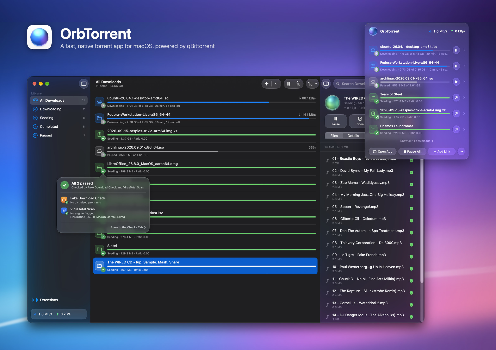

<p align="center">
  
</p>

<p align="center">
  <a href="https://github.com/sanjevirau/OrbTorrent/releases/latest"><b>Download for Mac</b></a>
  &nbsp;·&nbsp; Free and open source &nbsp;·&nbsp; macOS 26 or later &nbsp;·&nbsp; Apple silicon and Intel
</p>

OrbTorrent is a torrent app made for the Mac. It's written in SwiftUI with
Liquid Glass, lives in your menu bar, and downloads with
[qBittorrent](https://www.qbittorrent.org)'s engine underneath. Click a magnet
link in your browser and it's downloading.

It can keep your downloads on your VPN, hold fake downloads before they
arrive, and bring your downloads over from Transmission or qBittorrent. It's
free, with no ads, no account and no tracking.

## Features

### In your menu bar

- **Your downloads at a glance.** The menu bar icon is a small orb that fills
  up as your downloads progress. Click it for live speeds and your downloads,
  with pause, resume and open one click away, and more on a right-click.
- **Files without opening a window.** Click a download to see its files right
  in the panel, choose which ones to download, and set their priority.
- **Copied a magnet link?** The panel offers to add it.

### Adding downloads

- **Magnet links and `.torrent` files** open straight from your browser or
  Finder, or drag, drop or paste them in. OrbTorrent can be your Mac's default
  torrent app.
- **Choose before it starts,** or let it start right away. Pick the files and
  the folder, and see whether it fits on the disk before anything downloads.
- **Download in order,** to watch while it downloads. OrbTorrent gives the next
  file top priority and moves on as each one finishes, and you can drag files
  into the order you want.

### A full Mac window when you want it

- **Your library,** with Downloading, Seeding, Completed, Paused and Needs
  Attention in the sidebar, search, sorting, grouping by date or status,
  multi-select, context menus and keyboard shortcuts.
- **An inspector** for each download: its files, transfer details, the peers
  you're connected to and their countries, and how each tracker is doing.
- **Move a download's files** to another folder, check its data again, or ask
  its trackers for more peers.

### Private and safe

- **Download only through a VPN.** One switch ties OrbTorrent to your VPN. If
  the VPN drops, downloading and sharing stop instead of carrying on over your
  normal connection, and they continue once it's back. It works with VPN apps,
  and with tunnels such as Tunnelblick and WireGuard's `wg-quick`.
- **VPN port forwarding, kept in step.** A forwarded port lets other peers
  reach you, which makes downloads faster, but many VPNs give you a new one
  each time you connect. OrbTorrent picks it up by itself, from VPNs that
  forward ports over NAT-PMP and from Private Internet Access. If your VPN
  has you reserve a port in your account, as AirVPN and Windscribe do, enter
  it once.
- **Fake downloads held.** The Fake Download Check holds a download that looks
  fake, such as a "film" that contains a program, before any of it arrives,
  and waits for you to decide. VirusTotal Scan looks up finished downloads'
  files by their fingerprints. Each download's checks show in its inspector.
- **Deleting is safe.** A deleted download's files go to the Trash, so you can
  put them back.

### Looks after your Mac

- **Room for your Mac.** You're warned when a download won't fit, and
  OrbTorrent pauses downloads before the disk fills up, then resumes them once
  there's room again.
- **Notifications** when a download finishes, with Open and Show in Finder.
- **Speed limits and a seeding ratio,** so sharing doesn't slow down
  everything else.
- **Keeps your Mac awake** while it's downloading, if you like.

### Moving from another app

- **Import from Transmission or qBittorrent** in one step, when you first open
  OrbTorrent or any time after. Your downloads keep their save locations, file
  choices, names, labels, limits and history, and you choose which of the
  app's settings come over. qBittorrent's progress comes over as it is, and
  Transmission's downloads have their files checked before they go on.

### Under the hood

- **qBittorrent's engine,** bundled and run by OrbTorrent, with µTP, DHT, peer
  exchange, local peer discovery, web seeds, encryption, and UPnP and NAT-PMP
  to open your router's port.
- **More peers for public torrents.** OrbTorrent adds trackers from a public
  list that's tested every day, so slow downloads find more people to download
  from. Torrents from private trackers are never changed.
- **Updates itself,** with signed updates, and shows what's new after each one.

### Extensions

Extensions check your downloads at points in their life: before a download
starts, or after it finishes. Fake Download Check and VirusTotal Scan are the
first two, and you can turn extensions off to use OrbTorrent as a plain
torrent client.

Anyone can build one in TypeScript, or describe it to a coding agent such as
Claude Code, Codex or Cursor and let it write and test it. Each extension runs
in a sandbox, and can only reach the files and sites it lists, which its page
shows. See [docs/extensions](docs/extensions/README.md).

## Install

1. Download `OrbTorrent-<version>-universal.dmg` from
   [Releases](https://github.com/sanjevirau/OrbTorrent/releases/latest).
2. Open it and drag OrbTorrent to Applications.
3. Open OrbTorrent. It offers to bring over your downloads from Transmission
   or qBittorrent, and to become your default torrent app.

OrbTorrent needs macOS 26 (Tahoe) or later, on Apple silicon or Intel.

If macOS says it can't check OrbTorrent for malicious software, that build
isn't notarized by Apple yet. Open OrbTorrent once, then go to **System
Settings → Privacy & Security** and click **Open Anyway**.

To uninstall, quit OrbTorrent and drag it to the Trash. Your library and
settings are in `~/Library/Application Support/OrbTorrent`, if you'd like
them gone too. Your downloaded files stay where they are.

## Privacy

OrbTorrent collects nothing about you. There's no account, no analytics and no
crash reporting, and your library, settings and extension passwords stay on
your Mac. It connects only to:

- **Peers and trackers** for the downloads you add, as every torrent app does.
  They can see your IP address, unless you download through a VPN.
- **raw.githubusercontent.com**, for a public list of trackers, while "Find
  more peers for public torrents" is on.
- **Web addresses you add torrents from**, to fetch the `.torrent` file.
- **The sites an extension lists**, while it's on. Each extension's page shows
  them, and it can't reach any others.
- **updates.orbtorrent.com**, once a day, to check for a new version, while
  "Check for updates automatically" is on. It sends OrbTorrent's version and
  build number, which is how we count the Macs on each version. The address a
  check comes from isn't kept.
- **github.com**, to download an update you install.
- **download.db-ip.com**, once a month, for a database of which country each
  IP address is in, to show peers' flags. Peers are looked up in it on your
  Mac, and never sent anywhere.

Report a Problem, in the Help menu, only opens your own mail app with the
report filled in, and nothing is sent until you send it. The same note is in
the app, under **About OrbTorrent → Privacy**.

## Questions

**Is it legal?** Using BitTorrent is legal, and it's how Linux, open films and
large public datasets are shared. What you download is up to you: download and
share only what you have the right to.

**How does it use qBittorrent?** OrbTorrent bundles qBittorrent's engine,
built from its released source, and runs it in the background. It talks to it
through qBittorrent's own Web API, which only accepts connections from your
Mac. OrbTorrent isn't affiliated with or endorsed by the qBittorrent project.

**Is it an Electron app?** No. It's Swift and SwiftUI.

**Why only macOS 26?** It's built on this year's SwiftUI and Liquid Glass. One
app done well, rather than two done halfway.

**Will it stay free?** Yes. OrbTorrent is free and open source, under the GPL.

**What's coming next?** Playing videos while they download and remote access
are next. See the [roadmap](ROADMAP.md), which also lists what's been put off,
and why.

**Found a problem?** Choose **Help → Report a Problem** in the app, or open an
[issue](https://github.com/sanjevirau/OrbTorrent/issues/new/choose).

## For developers

OrbTorrent is a SwiftUI app that runs qBittorrent's engine, `qbittorrent-nox`,
as a background process and drives it through its Web API. Extensions run in
a separate, sandboxed helper. To build it, you need Xcode 26, Node.js 22.13
and a few tools from Homebrew:

```sh
brew install cmake ninja xcodegen
make engine   # build qBittorrent's engine (about 15 minutes the first time)
make dev      # build and open OrbTorrent Dev, which runs beside OrbTorrent
make test     # run the tests
```

[docs/development.md](docs/development.md) has the rest: how it works, the
engine build, OrbTorrent Dev, the project layout and how releases go out. To
build an extension, start with `npm create @orbtorrent/extension@latest` and
[docs/extensions](docs/extensions/README.md).

## Contributing

Bug reports, fixes and extensions are welcome. See
[CONTRIBUTING.md](CONTRIBUTING.md), and report security problems privately as
[SECURITY.md](SECURITY.md) says.

## License

Copyright © 2026 Sanjevi Rau. OrbTorrent is free software, released under the
[GNU General Public License v3.0 or later](LICENSE).

The bundled engine is built from these projects, whose licences ship inside the
app under `Contents/Resources/Licenses` and are shown in **About OrbTorrent →
Acknowledgements**:

- qBittorrent: GPL-2.0-or-later
- libtorrent: BSD-3-Clause
- Qt: LGPL-3.0 / GPL
- OpenSSL: Apache-2.0
- Boost: BSL-1.0

It also includes [Sparkle](https://sparkle-project.org) (MIT), which keeps it
up to date. Peers' countries come from DB-IP's IP to Country Lite database
([CC BY 4.0](https://creativecommons.org/licenses/by/4.0/)), which the engine
downloads each month: IP Geolocation by [DB-IP](https://db-ip.com).

The extension SDK in `sdk/`, published on npm as `@orbtorrent/api` and
`@orbtorrent/create-extension`, is MIT licensed ([sdk/LICENSE](sdk/LICENSE)),
so extensions can use any licence.

The exact source code of every bundled component comes from the URLs pinned in
`engine/versions.env`, and each release also attaches those source archives.

OrbTorrent isn't affiliated with or endorsed by the qBittorrent project. Download and
share only content you have the right to.

### Name and icon

The name OrbTorrent and the orb icon belong to Sanjevi Rau and aren't licensed
under the GPL (its section 7(e) allows this). You're welcome to fork OrbTorrent
under the GPL, but please give your version its own name and icon, so people
can tell it apart from the official app.
