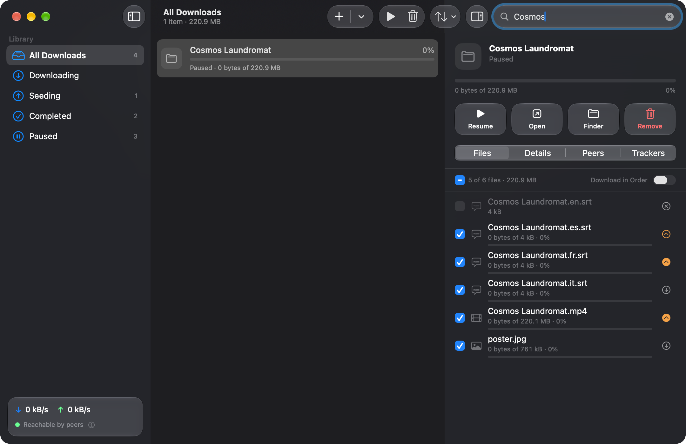
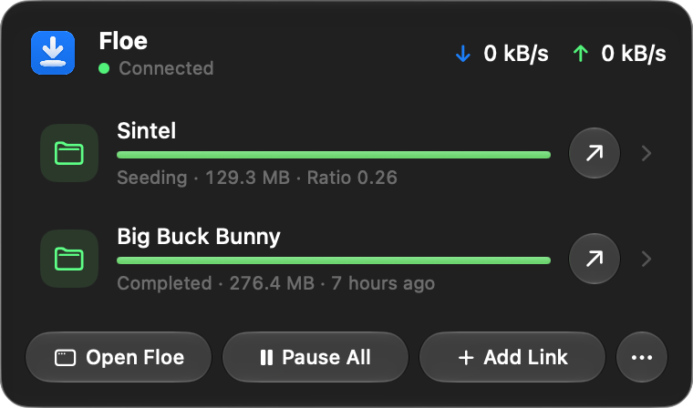
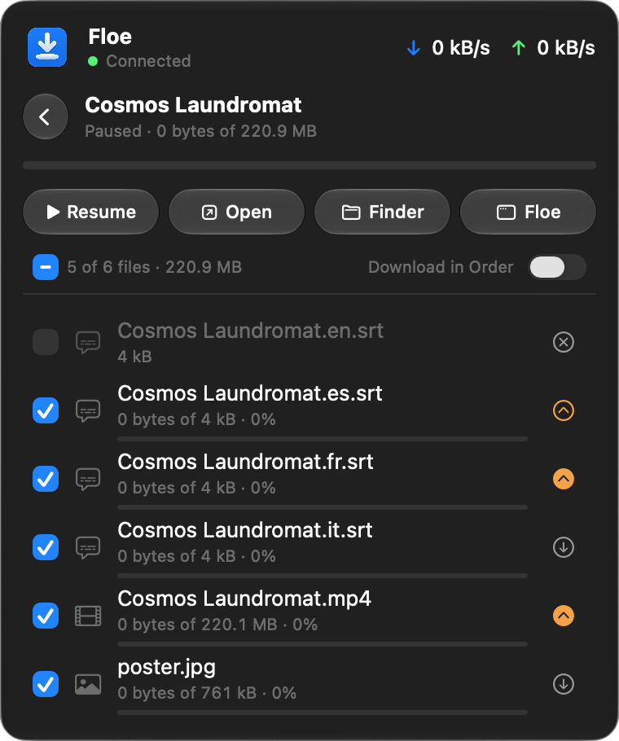

# OrbTorrent

A fast, native BitTorrent app for macOS, built with SwiftUI and Liquid Glass and
powered by the [qBittorrent](https://www.qbittorrent.org) engine.

OrbTorrent lives in your menu bar. Click a magnet link or open a `.torrent` file and
it starts downloading to your Downloads folder, the way Transmission does, with
qBittorrent's engine underneath: µTP, hole punching behind NAT, DHT, PeX, local
peer discovery, web seeds and encryption.



 

## Features

- **Opens magnet links and `.torrent` files** straight from your browser or Finder,
  or from drag and drop and paste.
- **Menu bar panel** with live speeds, your downloads and one-click pause,
  resume and open. Click a download to see its files right in the panel:
  tick or untick them, set their priority and open them.
- **Library window** with a sidebar, search, sorting, multi-select and context menus.
- **Per-file control:** pick which files to download and set their priority.
- **Download in order:** drag files into the order you want. OrbTorrent gives the next
  unfinished file top priority and moves on as each one completes.
- **Inspector** with files, transfer details, connected peers (TCP/µTP, incoming,
  encrypted) and tracker status.
- **Safe removal:** remove a download and keep its files, or move them to the
  Trash so they can be put back.
- **Notifications** when downloads finish, with Open and Show in Finder actions.
- **Extensions** that check downloads, like checks on a pull request, with
  their own page in the sidebar. The official **Fake Download Check** holds a download that looks fake, such as a
  film that contains a program, before any of it downloads. **VirusTotal Scan**
  looks up finished downloads' files by fingerprint. Anyone can build more in
  TypeScript, with the `orb` command-line tool; see
  [docs/extensions](docs/extensions).
- **Import from Transmission or the qBittorrent app**: downloads keep their save
  locations, file choices, names, labels, limits and history, and you choose which
  of the app's settings come over. qBittorrent's progress comes over as it is;
  Transmission's downloads have their files checked before they go on.
- **Settings** for save folder, speed limits, seeding ratio, port, UPnP/NAT-PMP,
  protocols, encryption, connection limits and launch at login.

## Requirements

macOS 26 (Tahoe) or later.

## Install

Download `OrbTorrent-<version>-universal.dmg` from
[Releases](../../releases), open it and drag OrbTorrent to Applications.

Release builds that aren't notarized need a one-time approval: open OrbTorrent, then
go to **System Settings → Privacy & Security** and click **Open Anyway**.

## Privacy

OrbTorrent collects nothing about you. There's no account, no analytics and no
crash reporting, and your library, settings and extension passwords stay on
your Mac. It connects only to:

- **Peers and trackers** for the downloads you add, as every torrent app does.
  They can see your IP address, unless you download through a VPN.
- **raw.githubusercontent.com**, for a public list of trackers, while "Find
  more peers for public torrents" is on.
- **Web addresses you add torrents from**, to fetch the `.torrent` file.
- **The sites an extension lists**, while it's on. Each extension's page shows
  them, and it can't reach any others.

The engine's lookup of peers' countries is off, so it never downloads a
country database. The same note is in the app, under **About OrbTorrent →
Privacy**.

## How it works

```
OrbTorrent.app
├── Contents/MacOS/OrbTorrent              SwiftUI app (menu bar, window, settings)
├── Contents/MacOS/qbittorrent-nox   qBittorrent's headless engine
├── Contents/MacOS/orb-extension-host  runs extensions, sandboxed
└── Contents/Resources/Extensions/   the official extensions
```

OrbTorrent starts `qbittorrent-nox` as a child process with its own profile in
`~/Library/Application Support/OrbTorrent/Engine` and talks to it through the
qBittorrent Web API:

- The API listens on `127.0.0.1` only, on a random free port.
- It's protected by a random password that OrbTorrent generates on first launch and
  stores readable only by you. It's saved in qBittorrent's PBKDF2 format.
- When OrbTorrent quits it asks the engine to shut down, so resume data is always saved.
  If the engine crashes, OrbTorrent restarts it.

The engine is statically linked: the binary depends only on macOS itself, so
OrbTorrent ships as one self-contained app.

Extensions run one at a time per hook in `orb-extension-host`, a small helper
with JavaScriptCore and the App Sandbox: it can't read files or reach the
network itself, and asks OrbTorrent for everything, which checks each request
against the extension's permissions. See
[docs/extensions/security.md](docs/extensions/security.md).

## Build from source

You need Xcode 26 or later, Node.js 22.13 or later (for the extensions), and
three command-line tools:

```sh
brew install cmake ninja xcodegen
```

Then:

```sh
make engine   # build qbittorrent-nox for this Mac (about 15 minutes the first time)
make dev      # build OrbTorrent Dev, quit the running copy and open the new one
make run      # build OrbTorrent.app and open it
make test     # run the unit tests
make test-extensions  # the extension SDK's and the official extensions' tests
make dmg      # package build/OrbTorrent-<version>-<arch>.dmg
make release  # universal engine, app and DMG
```

`make project` generates `OrbTorrent.xcodeproj` from `project.yml` if you'd rather
work in Xcode. The build embeds `engine/dist/qbittorrent-nox` and the official
extensions, which `make extensions` builds.

### OrbTorrent Dev

The Debug and Dev configurations build **OrbTorrent Dev**
(`com.orbtorrent.mac.dev`), so you can keep using OrbTorrent while you
work on it. It has its own library and engine in
`~/Library/Application Support/OrbTorrent Dev`, its own settings and Keychain
items, and an amber icon in the Dock and menu bar. It never opens magnet links
or `.torrent` files and doesn't start at login, leaving both to OrbTorrent.
Unit tests run inside it too. Point `orb dev` at it with `ORB_APP=dev`.

Builds are signed with a certificate from your Keychain when there is one
("Developer ID Application" or "Apple Development"), so macOS keeps the app's
permissions and Keychain access from one build to the next. Without one, as on
CI, they're signed ad hoc.

### The engine build

`engine/build.sh` builds every dependency from source, with nothing taken from
Homebrew or `/usr/local`:

| Component   | Version | Verified against |
|-------------|---------|------------------|
| qBittorrent | 5.2.3   | GPG signature (key `6E4A2D025B7CC9A2`) and qbittorrent.org checksum |
| libtorrent  | 1.2.20  | Pinned SHA-256 |
| Qt (qtbase + linguist tools) | 6.10.3 | download.qt.io SHA-256 |
| OpenSSL     | 3.6.4   | Upstream SHA-256 |
| Boost       | 1.86.0  | Upstream SHA-256 |

These versions mirror qBittorrent's own macOS release. Pins live in
`engine/versions.env`, and any fixes needed for newer toolchains live in
`engine/patches/<component>/`. Set `ARCHS="arm64 x86_64"` for a universal binary.

## Project layout

```
OrbTorrent/
  App/          App entry, delegate, commands, AppModel
  API/          qBittorrent Web API client and models
  Engine/       Engine process management and configuration
  Import/       Importing downloads and settings from Transmission and qBittorrent
  Store/        Library state, add flow, download order, notifications, file actions
  System/       Default app and login item integration
  Parsing/      Bencode, .torrent metadata and magnet links
  Extensions/   Running extensions: registry, runner, checks, settings, dev socket
  Views/        SwiftUI views (main window, inspector, menu bar, settings, onboarding)
  Resources/    AppIcon.icon and OrbTorrent Dev's AppIconDev.icon (Icon Composer)
ExtensionHost/  orb-extension-host, the sandboxed helper that runs extensions
extensions/     The official extensions (Fake Download Check, VirusTotal Scan)
sdk/            @orbtorrent/api: the extension API, the orb CLI and templates
skills/         The Agent Skill for building extensions
engine/         Engine build script, pinned versions and patches
scripts/        DMG packaging, extension docs and permission checks
```

## License

Copyright © 2026 Sanjevi Rau. OrbTorrent is free software, released under the
[GNU General Public License v3.0 or later](LICENSE).

The bundled engine is built from these projects, whose licences ship inside the
app under `Contents/Resources/Licenses` and are shown in **About OrbTorrent →
Acknowledgements**:

- qBittorrent: GPL-2.0-or-later
- libtorrent: BSD-3-Clause
- Qt: LGPL-3.0 / GPL
- OpenSSL: Apache-2.0
- Boost: BSL-1.0

The exact source code of every bundled component comes from the URLs pinned in
`engine/versions.env`, and each release also attaches those source archives.

OrbTorrent isn't affiliated with or endorsed by the qBittorrent project. Download and
share only content you have the right to.

### Name and icon

The name OrbTorrent and the orb icon belong to Sanjevi Rau and aren't licensed
under the GPL (its section 7(e) allows this). You're welcome to fork OrbTorrent
under the GPL, but please give your version its own name and icon, so people
can tell it apart from the official app.
