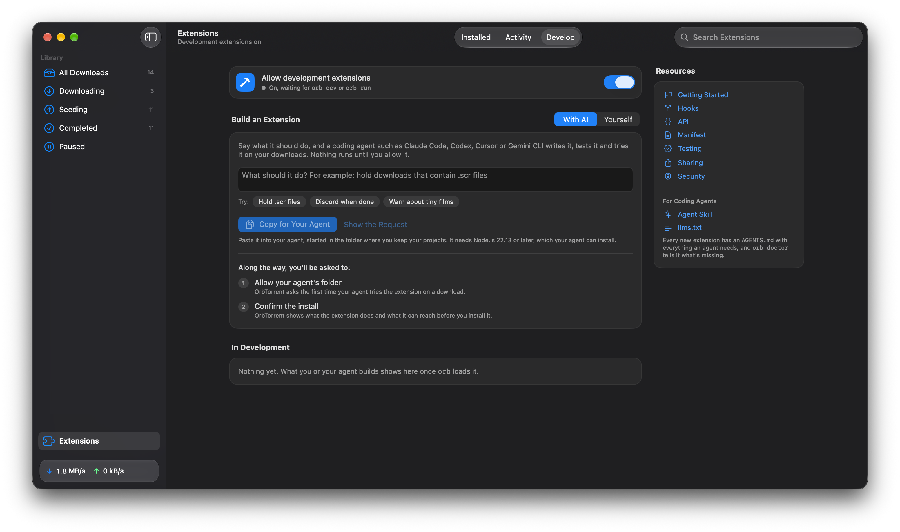

You don't have to write an extension yourself. Say what it should do, and a coding agent such as **Claude Code**, **Codex**, **Cursor** or **Gemini CLI** writes it, tests it and tries it on your downloads. Nothing runs in OrbTorrent until you allow it.

## From OrbTorrent

1. Open **Extensions**, at the bottom of OrbTorrent's sidebar, then the **Develop** tab.
2. Under **Build an Extension**, choose **With AI**.
3. Say what it should do, such as "Hold downloads that contain Windows screensaver (.scr) files", or pick one of the ideas under the box.
4. Click **Copy for Your Agent**, and paste it into your coding agent, started in the folder where you keep your projects.



The agent needs Node.js 22.13 or later, which it can install. It then makes the extension from a template, reads the instructions that come with it, writes the code and its tests, and loops until the tests, the build and the linter all pass.

## What only you can do

OrbTorrent keeps three steps for you, so nothing reaches your torrent app without you:

1. **Allow development extensions.** The switch at the top of the **Develop** tab, so your agent can load what it builds.
2. **Allow your agent's folder.** OrbTorrent asks the first time the agent tries the extension on one of your downloads.
3. **Confirm the install.** OrbTorrent shows what the extension does and what it can reach, before you install it.

Your agent asks you for each one when it gets there, and can't get around them.

## Without the app

The request OrbTorrent copies is plain text, so you can write it yourself. Replace the first line with what you want:

```txt title="Request"
Build an OrbTorrent extension for me. What it should do: hold downloads that contain .scr files

OrbTorrent is a BitTorrent app for macOS. Its extensions are TypeScript hooks, made and tested with the `orb` tool from the @orbtorrent/api npm package. You need Node.js 22.13 or later.

1. Make it with `npm create @orbtorrent/extension@latest <a short name>`. Add `-- --template after-finish` if it should act once a download finishes. Then run `npm install` in the new folder.
2. Read AGENTS.md in the new folder. If what I asked for needs something extensions can't do, tell me before you build it. Then follow its loop until `npx orb test`, `npx orb build` and `npx orb lint` all pass.
3. Run `npx orb doctor`, and ask me to do anything it says only I can do in OrbTorrent.
4. Try it on one of my downloads: `npx orb downloads`, then `npx orb run <hook> --download "<name>"`. OrbTorrent asks me to allow the folder the first time.
5. When it works, run `npx orb install`, and I'll confirm the install in OrbTorrent.
```

## What agents read

Everything an agent needs comes with the extension, so it doesn't depend on what the agent already knows:

- **`AGENTS.md`,** in every new extension: the whole API, the manifest, the hooks, the test format, the rules for good results, and the errors it'll see with their fixes. Claude Code reads it through the extension's `CLAUDE.md`, Codex and Cursor read it by themselves, and the request asks any agent to read it.
- **`orb doctor`,** which checks Node.js, OrbTorrent and the extension, and says what to fix. Each problem it finds has a `fix` that says how, including when only you can do it.
- **The Agent Skill,** [`build-orbtorrent-extension`](https://github.com/sanjevirau/OrbTorrent/tree/main/skills/build-orbtorrent-extension), for agents that use the Agent Skills format. It has the same instructions as `AGENTS.md`.
- **These docs,** as Markdown. [llms.txt](/docs/extensions/llms.txt) lists the extension docs, and [llms-full.txt](/docs/extensions/llms-full.txt) has all of them in one file. Every page is also Markdown at its address plus `.md`.

## Made for agents

`orb` is built to be driven by a program as much as by a person:

- **Every command takes `--json`,** and prints one JSON object an agent can read.
- **Nothing prompts.** Commands that need you, such as installing, wait for your answer in OrbTorrent, then say what you chose.
- **Every command exits with 1 when something's wrong,** with what's wrong and how to fix it.
- **Tests run without OrbTorrent,** with the network mocked and time on a virtual clock, so an agent can check its work in seconds.

```json title="npx orb test --json"
{
  "ok": true,
  "passed": 3,
  "failed": 0,
  "tests": [
    {
      "file": "tests/holds-a-screensaver.json",
      "name": "Holds a download with a screensaver in it",
      "passed": true,
      "failures": [],
      "result": {
        "status": "failed",
        "summary": "Contains a screensaver, which is a Windows program: Play Me.scr"
      },
      "logs": [],
      "fetched": []
    }
  ]
}
```

[The orb command](/docs/extensions/reference/cli) has every command's JSON.

## Tips

- **Say what should pass, as well as what should be caught.** "Hold films that contain a program, but not software or games" gives the agent the tests that matter.
- **Ask for the narrowest permissions.** An agent asks for what the extension needs, but it's worth checking `package.json` before you confirm the install.
- **Read the install sheet.** It lists what the extension can do, and that's what OrbTorrent enforces.
- **Using OrbTorrent Dev?** If you build OrbTorrent itself, tell the agent to put `ORB_APP=dev` before every `npx orb` command. The Develop tab adds this to the request for you.
