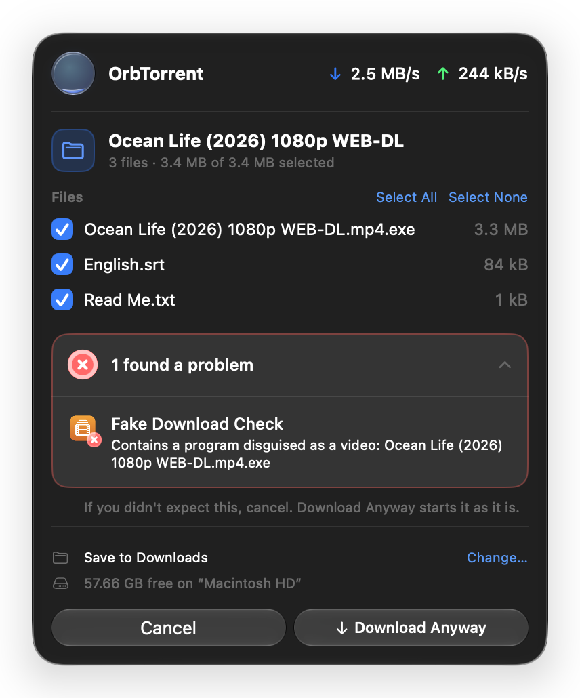

To try OrbTorrent, download something you're allowed to share, such as a Linux image: Ubuntu, Fedora and Debian all offer torrents on their download pages.

## Add a download

OrbTorrent takes magnet links, `.torrent` files, and web links to `.torrent` files. Use whichever is closest:

- **Click a magnet link in your browser**, or open a `.torrent` file in Finder. This works once OrbTorrent is your Mac's [default torrent app](/docs/reference/settings#general).
- **Drag a `.torrent` file** onto the OrbTorrent window.
- **Paste** a magnet link or a link to a `.torrent` file into the OrbTorrent window, with <kbd class="key">⌘V</kbd>.
- **Copy a magnet link**, then open the menu bar panel: it offers **Add “…” from Clipboard**.
- Choose **File › Add Magnet Link…** (<kbd class="key">⌘U</kbd>) or **File › Open Torrent File…** (<kbd class="key">⌘O</kbd>), or click **Add Link** in the menu bar panel.

If the download is already in your library, OrbTorrent says so rather than adding it twice.

## Choose what to download

OrbTorrent asks before downloading, so you can check what's coming first. Links from your browser and files from Finder are asked about in the **menu bar panel**; downloads you add in the window are asked about there.

- **Files.** Untick any you don't want. **Select All** and **Select None** are above the list. A download with one file has no list.
- **Checks.** If your [extensions](/docs/guides/checks) check downloads before they start, their results show here. If one finds a problem, the button becomes **Download Anyway**.
- **Save to.** Where the files go. Click **Change…** to choose another folder for this download.
- **Free space.** How much room the disk has. If the download won't fit, OrbTorrent says so before anything downloads.

Click **Download** to start. Adding in the window also offers **Start right away**, and **Download in order, to watch while it downloads**.

:::tip[Magnet links]
A magnet link doesn't carry a download's file list. OrbTorrent asks peers for it, and the list appears once one answers, usually within seconds. If you [download only through a VPN](/docs/guides/vpn) and it isn't connected, the list waits for the VPN.
:::

If you'd rather downloads start without asking, choose **Start downloading right away** in **Settings › General**. Extensions still check each download, and hold one that looks wrong.

## Watch it download

- The **menu bar orb** fills with blue light as your downloads progress. Click it for each download's speed and time left.
- The **library window** shows every download, and the inspector shows one in detail: its files, peers and trackers.
- When the download finishes, a notification says so, with **Open** and **Show in Finder**.

## When it's done

A finished download keeps **seeding**: sharing what you downloaded with other people, the way BitTorrent works. You can [limit how much it shares](/docs/guides/speed-and-sharing), or pause it.

To open it, click the arrow next to it in the menu bar panel, or double-click it in the library. **Show in Finder** (<kbd class="key">⌘R</kbd>) shows its files.

To remove it, select it and press <kbd class="key">⌘⌫</kbd>. You can remove it from OrbTorrent and keep its files, or remove its files too. Unless you've [changed it](/docs/reference/settings#deleting-downloads), removed files go to the Trash, so you can put them back.

## Next

- [The menu bar](/docs/guides/menu-bar)
- [The library window](/docs/guides/library)
- [Choose files and their order](/docs/guides/files)
