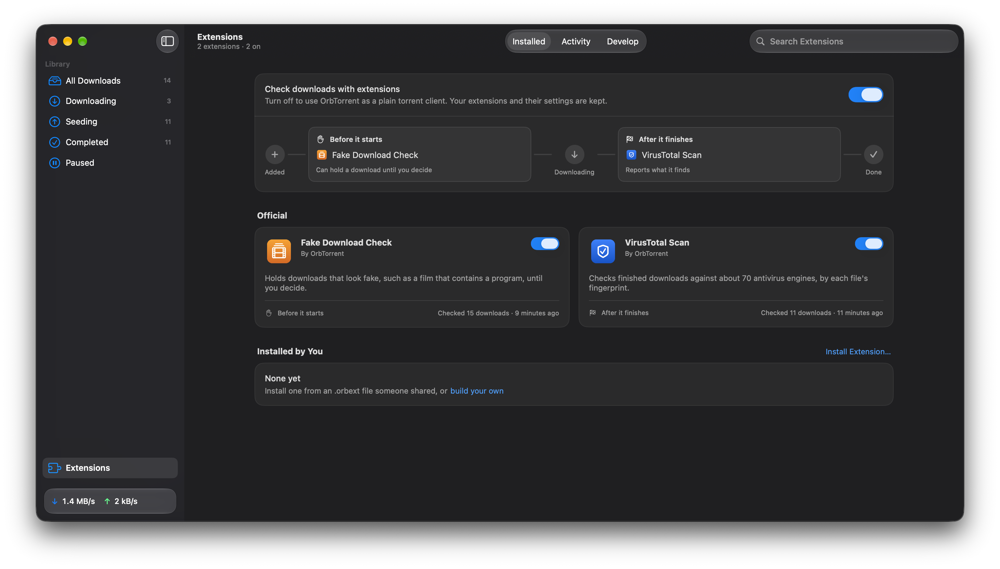
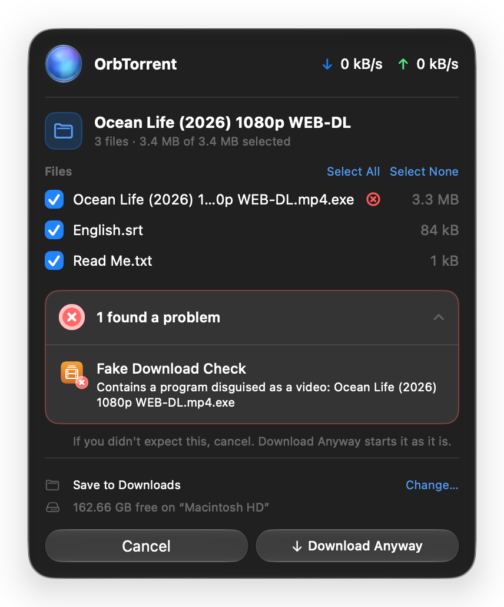

Extensions check your downloads at two moments: **before a download starts**, when they can hold it until you decide, and **after it finishes**. Their results show in each download's **Checks** tab.

OrbTorrent comes with two:

- **Fake Download Check** runs before a download starts, and is on from the start. It holds a download that looks fake, such as a film that contains a program.
- **VirusTotal Scan** runs once a download finishes. It looks up each file on VirusTotal, which checks it against about 70 antivirus engines. It's off until you add a free VirusTotal key.

## The Extensions page

Click **Extensions** at the bottom of the window's sidebar.

It has three tabs:

- **Installed** shows which extensions check downloads at each point, with a switch for each one. Click an extension for its page: what it does, what it can reach, its settings, its recent checks and its log.
- **Activity** lists every check on every download, newest first. Show **Problems** only, or one extension's checks. Right-click a check to see the download's checks, run it again, or copy the result.
- **Develop** is for [building your own](/docs/extensions).

## What a check can say

| Result | Means |
|---|---|
| **Passed** | Nothing wrong. |
| **Warning** | Worth a look. The download carries on, with a badge. |
| **Failed** | Something's wrong. Before a download starts, this **holds** it. After it finishes, you get a notification. |
| **Skipped** | The check didn't apply, or couldn't run, such as with no internet connection. |
| **Didn't finish** | The extension failed, or took too long. A check that doesn't finish never stops a download. |

After a download finishes, a warning sends a notification too, so you don't miss it. A check can also tell you about something it did, such as adding subtitles.

If you download only some of a download's files and choose more later, its checks run again once those finish. They tell you only about what's new, not what they found before.

## Which file

When a check finds something wrong with a particular file, OrbTorrent marks it, in red or yellow, beside the file: in the download's **Files** tab and the menu bar panel, with what the check found, and before anything downloads, in the confirmation's list of files. The check lists those files too, each with **Show in Finder** and, from VirusTotal Scan, its report.

## Reports on the checks

Some extensions don't check downloads, but pass on what the checks found, such as in a message to your phone. They run once a download's checks are done, and when a check holds a download. They show under **After its checks** in the Checks tab, apart from the checks, and an extension's page says when it can see what other extensions found.

## Files a check added

Some extensions add files next to a finished download's, such as subtitles in your language or a film's poster. A check lists any it added, with **Show in Finder**.

They belong with the download. **Move To…** takes them along, and removing the download with its files removes them too. An extension only ever adds subtitles, text, images or checksums, never a program, and never replaces a file it didn't add.

## A held download

When a check fails before a download starts, OrbTorrent holds it: nothing downloads until you decide.

- **If OrbTorrent asked about the download,** the check's result shows in the confirmation, and the button becomes **Download Anyway**.

  

- **If the download started on its own,** OrbTorrent stops it the moment its file list arrives, holds it, and sends a **Download Held** notification. The menu bar panel shows it too: **"… is held by a check."**

To decide, open the download's **Checks** tab, from the notification or **Review** in the menu bar panel. It says what the check found. Then:

- **Download Anyway** starts it as it is.
- **Remove…** removes it. If you didn't expect what the check found, this is the one to choose.

## Fake Download Check

Before any of a download arrives, the Fake Download Check looks at the **names and sizes** of its files for the signs of a fake. It sends nothing anywhere.

**It holds a download when:**

- a file has a double extension that ends in a program or shortcut, such as `Film.mp4.exe`, `Atomic Habits.epub.exe` or `Sunset.jpg.app`. Spaces, invisible characters and right-to-left characters that make a name read backwards don't hide it.
- a film, episode, album or book includes a program: a Windows program, script or shortcut, or a Mac app, installer, AppleScript or screensaver. A film never needs one.
- a film or episode is an archive with a file about a password. The video is locked, and the password is sold or hidden elsewhere.

**It warns, and lets the download start, when:**

- a film is far too small for the quality its name claims: under 150 MB at 720p, 300 MB at 1080p or 1 GB at 2160p.
- a film is from a year that hasn't come yet.
- the only video is `.wmv` or `.asf`, the classic "codec required" fake.
- link files say to download or watch elsewhere.
- a film-like name has no video, or its video is inside an archive.
- a course includes a program. Courses often include the software they teach, so it warns rather than holds.

Software, games and courses carry programs for good reason, so programs only count in films, episodes, music and books. Names and sizes can't show a fake whose names and sizes look right, such as a "film" that's really a different video. VirusTotal Scan checks files once they arrive.

## VirusTotal Scan

When a download finishes, VirusTotal Scan looks up each file's fingerprint (its SHA-256) on [VirusTotal](https://www.virustotal.com). Only the fingerprint is sent, not the file.

| Result | When |
|---|---|
| **Failed** | 3 or more engines call a file malicious. |
| **Warning** | 1 or 2 engines do, or any call it suspicious. Single-engine false alarms are common. |
| **Passed** | No engine flags any file VirusTotal knows. Files it has never seen are listed in the details: new releases often haven't been seen yet. |
| **Skipped** | VirusTotal hasn't seen any of the files, or the key wasn't accepted, or the daily limit was reached before every file was checked. Run it again later. |

### Set it up

1. Sign up or sign in at [virustotal.com](https://www.virustotal.com).
2. Open your profile menu and choose **API key**, then copy the key.
3. In OrbTorrent, open **Extensions**, then **VirusTotal Scan**. Paste the key into **API key** and click **Verify**.
4. Turn it on with the switch on its page.

The key is kept in your Mac's Keychain. The free key allows 4 lookups a minute and 500 a day, so VirusTotal Scan waits between lookups, and a download with many files takes a few minutes. It remembers answers for a week, so running it again doesn't use up your limit. VirusTotal's terms allow the free key for personal use, not in commercial products or services.

### Its settings

- **Files to check.** **Programs, archives and documents**, checked in that order, or **All files**, which includes videos and music. Each lookup counts towards your daily limit.
- **Files VirusTotal hasn't seen.** Off unless you turn it on: **Upload them to be scanned**, up to 32 MB each. Uploaded files are shared with VirusTotal's paying customers, so leave this off for anything private.

## Install an extension

Extensions come as `.orbext` files. To install one, open it in Finder, or choose **File › Install Extension…**, or click **Install Extension…** on the Extensions page.

OrbTorrent shows what the extension does before you install it: who made it, when it runs, and what it **can** do, such as read the contents of your downloads, add files such as subtitles next to them, or connect to a site. When you update an extension, anything new it asks for is marked **New**.

:::caution[Only install extensions from people you trust]
Extensions from anyone other than OrbTorrent are marked **Not reviewed by OrbTorrent**. OrbTorrent enforces what an extension says it can do, so it can't read other files or reach other sites, but nobody has reviewed its code. [Security model](/docs/extensions/security) explains the limits.
:::

## Turn extensions off

- **One extension:** turn off its switch on the **Installed** tab or its page. Its settings are kept.
- **All of them:** turn off **Check downloads with extensions** at the top of the **Installed** tab. OrbTorrent then works as a plain torrent client: nothing is checked, and checks don't show. Your extensions and their settings are kept for when you turn them back on.
- **Remove one:** click **Uninstall…** at the bottom of its page. Its settings, including any API key, are deleted too. The official extensions can be turned off, but not removed.

## Something to check?

If a check found something you didn't expect, or an extension keeps saying **Didn't finish**, open its page: its **Logs** show what it did. [Troubleshooting](/docs/help/troubleshooting#an-extension-didnt-finish) has more.
