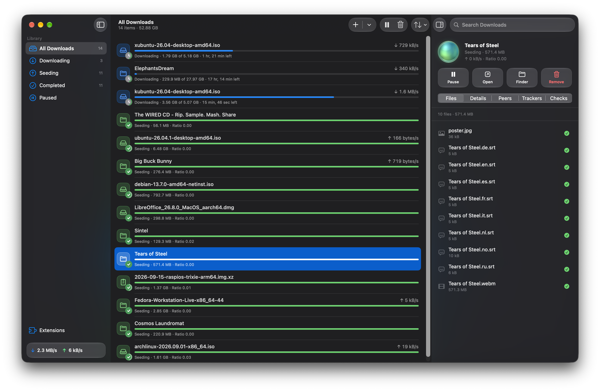

The OrbTorrent window has every download, and everything you can do with them. Open it with **Open App** in the menu bar panel, or by opening OrbTorrent from your Applications folder.

## The sidebar

The sidebar sorts your downloads into sections, each with how many it holds:

| Section | Shows |
|---|---|
| **All Downloads** | Everything in your library. |
| **Downloading** | Unfinished downloads that are running. |
| **Seeding** | Finished downloads you're sharing. |
| **Completed** | Everything that's finished, seeding or not. |
| **Paused** | Downloads you've paused, and those held by a check. |
| **Needs Attention** | Downloads with an error. It only shows when there are some. |

At the bottom are **Extensions**, which opens [the Extensions page](/docs/guides/checks), and your total speeds. When something's wrong, the speeds make way for what it is, such as **Waiting for VPN** or **Disk almost full**. Point at it for more. While you [download through a VPN](/docs/guides/vpn), it says which.

## The list

Each download shows its name, progress, speed, and a line saying what it's doing:

| Status | Means |
|---|---|
| **Downloading** | Receiving data, with how much is done and the time left. |
| **Waiting for Peers** | Running, but no one is sending it anything right now. |
| **Fetching Info** | A magnet link waiting for its file list from peers. |
| **Checking** | Checking the files on disk against the torrent. |
| **Moving** | Moving its files to another folder. |
| **Seeding** | Finished, and sharing with other people. |
| **Completed** | Finished, and not sharing. |
| **Paused** | Stopped until you resume it. |
| **Files Missing** | Its files were moved or deleted outside OrbTorrent. |
| **Error** | Something went wrong, such as a disk that's full or no longer connected. |

**Double-click** a download to open it. Select several with <kbd class="key">⌘</kbd>-click or <kbd class="key">⇧</kbd>-click, or all of them with <kbd class="key">⌘A</kbd>.

## The toolbar

- **Add (+)** adds a magnet link. Hold it, or click its arrow, for **Open Torrent File…**.
- **Pause** or **Resume**, and **Remove**, act on the selected downloads.
- **Sort and Group** orders the list by **Date Added**, **Name**, **Progress**, **Size** or **Download Speed**, and splits it into groups by **Date Added** or **Status**, as Finder does.
- **Inspector** shows or hides [a download's details](/docs/guides/download-details) on the right (<kbd class="key">⌘I</kbd>).
- **Search Downloads** finds downloads by name.

## The right-click menu

Right-click a download, or several, for:

- **Open** and **Show in Finder**
- **Pause** or **Resume**
- **Download Sequentially**, which downloads its pieces in order, to watch a video while it downloads
- **Copy Magnet Link**
- **More › Ask Trackers for More Peers**, **Verify Local Data** and **Move To…**
- **Remove…**

[A download's details](/docs/guides/download-details#actions) explains what each of the **More** actions does.

## Add downloads here

Drag a `.torrent` file onto the window, or paste a magnet link or a link to a `.torrent` file with <kbd class="key">⌘V</kbd>. OrbTorrent asks about it in the window, where you can also choose to start it straight away or download it in order.

## Remove downloads

Select one or more downloads, then press <kbd class="key">⌘⌫</kbd>, or click **Remove** in the toolbar. You choose:

- **Remove from OrbTorrent**, which keeps the downloaded files where they are.
- **Remove and Move Files to Trash**, which you can undo by putting them back from the Trash.

If you've set OrbTorrent to [delete files permanently](/docs/reference/settings#deleting-downloads), the second choice is **Remove and Delete Files Permanently** instead, and the files can't be put back.

## Banners

A banner at the top of the window appears when:

- **OrbTorrent isn't your default torrent app.** Click **Make Default**, or **Not Now** to stop it asking.
- **A new version is available.** See what's new, and install it when you're ready.
