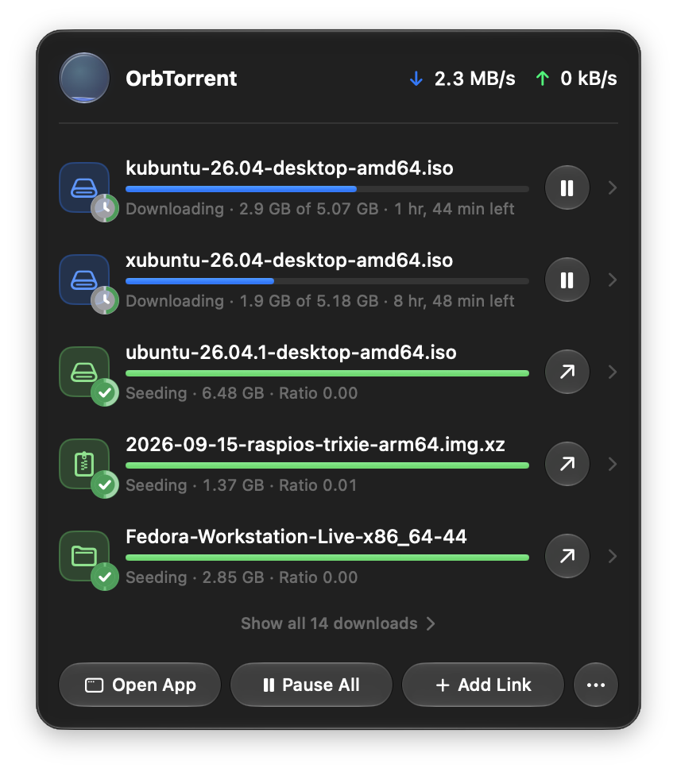

OrbTorrent lives in your menu bar, so your downloads are a click away without a window open.

## The orb

The orb in the menu bar is all your downloads at a glance. It fills up as they progress, and its colour says how they're doing:

| Colour | Means |
|---|---|
| **Blue** | Downloading. The faster it goes, the livelier the light moves. |
| **Amber** | Waiting: for peers, for a magnet link's file list, for files being checked or moved, or for your VPN. |
| **Grey** | Paused. |
| **Green** | Finished, or seeding. |
| **Red** | Something needs attention, such as a download with an error, or the download engine stopped. |

When some downloads are moving, the orb shows those. Otherwise it shows the one that matters most: an error first, then seeding, then waiting, then paused.

## The panel

Click the orb to open the panel.

- **At the top,** your total download and upload speeds.
- **Your downloads,** busiest first: running ones fastest first, then paused ones, then finished ones. Each shows its progress and what it's doing, such as "Downloading · 2.9 GB of 5.07 GB · 1 hr, 44 min left". With more than six, the list scrolls.
- **At the bottom,** **Open App** opens the OrbTorrent window, **Pause All** or **Resume All** does as it says, and **Add Link** adds a magnet link. **More (…)** has the rest.

A strip at the top of the list tells you when something needs a look:

- **"… is held by a check."** An extension held a download before it started. Click **Review** to see why, and decide. [Checks and held downloads](/docs/guides/checks) explains.
- **"OrbTorrent … is available."** A new version was found while OrbTorrent was in the background. Click **Update** to see what's new and install it.

If you've copied a magnet link, the panel offers to add it: **Add “…” from Clipboard**.

## A download in the panel

Each download has a button at its end: **Pause** or **Resume** while it's downloading, and **Open** once it's finished.

**Click a download** to see its files right in the panel. You can open a finished file, choose which files to download, and set their priority, just as in the window. [Choose files and their order](/docs/guides/files) explains how. **Back** returns to the list.

**Right-click a download** for more:

- **Open** and **Show in Finder**
- **Pause** or **Resume**
- **Copy Magnet Link**
- **Show in OrbTorrent**, which opens it in the window
- **Delete…**

**Point at a download** and a **Delete** button appears. Deleting from the panel removes the download and its files, which go to the Trash, or are erased if you've [changed that](/docs/reference/settings#deleting-downloads). It asks first, saying how much will go.

## The More menu

**More (…)** at the bottom of the panel has:

- **About OrbTorrent**
- **Check for Updates…**
- **Settings…** (<kbd class="key">⌘,</kbd>)
- **Open Torrent File…**
- **Report a Problem…**
- **Quit OrbTorrent** (<kbd class="key">⌘Q</kbd>)

## Asking before a download

When you click a magnet link in your browser or open a `.torrent` file in Finder, OrbTorrent asks about it in the panel: which files, where to save them, and whether they fit. If several arrive at once, it asks about each in turn, showing "1 of 3". [Your first download](/docs/get-started/first-download#choose-what-to-download) walks through it.

## If the engine stops

OrbTorrent downloads with qBittorrent's engine, which runs in the background. If it stops, the orb turns red and the panel says **Download engine stopped**. Click **Restart**. If it keeps stopping, see [Troubleshooting](/docs/help/troubleshooting#the-download-engine-stopped).
